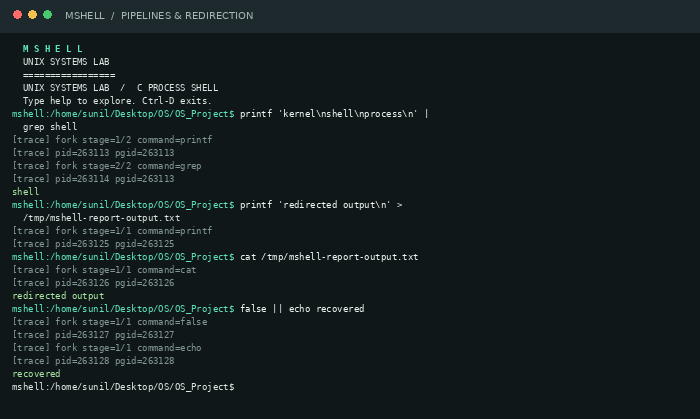
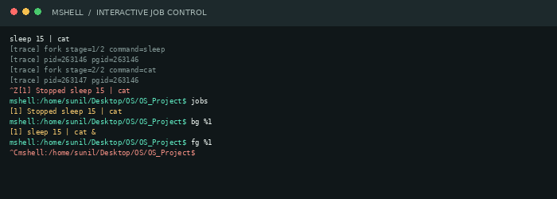

# LABORATORY TECHNICAL REPORT: MSHELL UNIX-STYLE COMMAND SHELL

*Design and Implementation of a Unix-Style Command Shell*

**Student Name & Roll No:** Khethavath Sunil Naik (12341170)  
**Course & Institution:** CSL301 Operating Systems | Indian Institute of Technology Tirupati  
**Project:** MShell (C, POSIX)  
**Repository:** github.com/Sunil0012/mshell-unix-shell

---

## 1. Introduction, Problem Context and Objective

MShell is a compact command interpreter written in C for Linux and POSIX-style systems. It launches programs, connects them with pipes, redirects file descriptors, and manages foreground and background jobs. Its interactive mode supports terminal job control, allowing a user to suspend and resume a pipeline with keyboard signals. The implementation brings core operating-systems interfaces together in one inspectable program.

A shell is a user-space program that interprets commands and coordinates other processes. Building one makes operating-systems behavior visible: commands become child processes, pipes carry bytes between them, and the terminal assigns keyboard control to a foreground process group.

MShell demonstrates four related tasks:

- Create a process for a command and replace its program image with `execvp`.
- Connect pipeline stages and route standard input, output, and error through file descriptors.
- Keep each pipeline in a process group and transfer terminal foreground ownership when needed.
- Make behavior reproducible through scripts, trace output, integration checks, and a bounded benchmark.

The project does not attempt full Bash or POSIX shell compatibility. It omits command substitution and several advanced grammar features. This report describes the shell’s execution path, design choices, supported language, and known limits. Its evidence includes terminal sessions, recorded smoke and pseudo-terminal checks, a Bash comparison, and a repeated process-launch benchmark. Results apply to the implemented features and recorded setup.

## 2. System Design

### 2.1 Read, parse, execute

In interactive mode, MShell prints a prompt and reads one line at a time. Script mode reads a file and also recognizes a limited set of control constructs. A command line is divided at command-list operators, tokenized with basic quote and backslash handling, and expanded for environment variables and wildcard patterns. The parser groups words and redirections into pipeline stages.

For each stage, the parent creates a pipe when another stage follows, then calls `fork`. In the child, MShell joins the pipeline’s process group, connects the previous pipe to standard input and the next pipe to standard output, applies explicit redirections, closes descriptors it no longer needs, and runs a builtin or calls `execvp`. The parent closes its copies of the pipe ends and records child PIDs. It waits for a foreground pipeline or returns to the prompt for a background job.

A state-changing builtin such as `cd`, `export`, or `unset` must run in the shell process when entered by itself; running it in a child would discard its effect when that child exits. A builtin inside a pipeline runs in a child, so its changes do not affect the parent shell. This distinction follows from process isolation rather than a special property of the command name.

### 2.2 Processes, pipes, and descriptors

`fork()` creates a child with a copy of the parent’s process state. The child configures its descriptors and then `execvp()` replaces its process image with the selected program. The process ID remains the same across `exec`; the program code and memory image change.

A pipeline of *N* commands needs *N − 1* pipes. `pipe()` returns a read descriptor and a write descriptor. `dup2()` maps the chosen end onto standard input or standard output. Explicit redirections open files and map them onto descriptor 0, 1, or 2. Correct closure matters: if any process keeps a pipe’s write end open, a reader may wait forever instead of seeing end-of-file.

The parent uses `waitpid()` to collect child status and, in interactive mode, to observe stopped and continued children. The kernel schedules runnable processes; MShell does not implement a CPU scheduler. Its role is to create processes and coordinate their input, output, and lifecycle.

### 2.3 Job control and the terminal

On an interactive terminal, the shell establishes its own process group and takes foreground ownership. The processes in one pipeline share a job process group. Before waiting for a foreground job, MShell gives that group the terminal with `tcsetpgrp()`. When the job completes or stops, the shell reclaims the terminal.

The terminal sends Ctrl-C and Ctrl-Z signals to the foreground process group. The shell tracks child state through `waitpid()` events. `jobs` lists active entries; `bg` continues a stopped group in the background; `fg` continues it after returning terminal ownership. This design allows a multi-process pipeline to behave as one job from the user’s perspective.

### 2.4 Command language

MShell supports external programs found through `PATH`; pipelines; input, output, append, and standard-error redirection; here-documents; background execution with `&`; and command lists separated by `;`, `&&`, and `||`. It expands `$NAME`, `${NAME}`, and `$?`, and performs filename globbing.

Builtins include `cd`, `pwd`, `export`, `unset`, `jobs`, `fg`, `bg`, `history`, `alias`, `unalias`, `source`, `help`, and `exit`. Script files support simple `if`/`else`/`fi` blocks, `for NAME in values; do ... done` loops, and no-argument function definitions. Single and double quotes and backslash escaping are supported in a limited form.

The script grammar is intentionally restricted: blocks cannot nest, functions have no positional parameters, and aliases replace one command word. Command substitution and full POSIX/Bash parsing are not implemented. These boundaries are important when interpreting the compatibility results.

## 3. Implementation Notes

The central structures in `minish.c` represent a command’s argument vector and redirection paths, a job’s process-group ID and lifecycle state, and child-to-job associations. A pipeline is launched stage by stage. The parent and child both call `setpgid` around each fork, reducing timing races over process-group membership. For interactive foreground work, the terminal handoff brackets the wait loop.

The parser and executor are kept in one C source file, which makes the control flow easy to locate but leaves some functions dense. Error paths report failed system calls or invalid syntax; command lookup errors use conventional nonzero statuses. Here-document bodies are staged through temporary files. The trace mode prints each pipeline stage, child PID, and process-group ID to standard error. It is an application diagnostic that exposes MShell’s own decisions, not a kernel event trace.

## 4. Captured Demonstrations

The following images were captured from live pseudo-terminal sessions of the project executable. The first shows a two-stage pipeline, descriptor redirection, and conditional execution. The second uses terminal-generated Ctrl-Z and Ctrl-C signals to demonstrate job control across a pipeline.

*Figure 1. A traced `printf | grep` pipeline, output redirected to a file and read back, and an `||` recovery command. The two pipeline processes have distinct PIDs and share one PGID.*

*Figure 2. A `sleep | cat` pipeline stopped with Ctrl-Z, listed as one stopped job, resumed in the background, foregrounded, and interrupted with Ctrl-C.*

## 5. Verification and Compatibility

The repository contains three repeatable checks, and the recorded development output reports that all passed:

1. **Smoke checks** exercise conditional lists, pipelines, globbing, error redirection, here-documents, aliases, sourcing, script control flow, exit status, and process tracing.
2. **Bash comparison** runs a small shared command subset in MShell and Bash and compares their output. It checks selected behavior, not the complete shell language.
3. **Pseudo-terminal job control** starts a two-process pipeline, sends Ctrl-Z, checks the stopped state, resumes it with `bg` and `fg`, and sends Ctrl-C. This exercises signals delivered through a terminal rather than only calling builtins.

The saved output in `report-evidence/test-output.txt` records the three successful checks. `report-evidence/trace-output.txt` shows two children in one pipeline process group, followed by a conditional command. The screenshots provide an additional readable record of the live interactions. Re-run the checks from the project root with `make test` when validating a new build.

## 6. Process-Launch Benchmark

The benchmark repeatedly launches `/bin/true` in each shell. The driver performs a warm-up, alternates run order, and uses a monotonic clock. It reports the median, interquartile range (IQR), minimum, maximum, and paired differences, and stores raw samples in CSV. The report’s supplied dataset contains 25 measured runs per shell with 3,000 launches per run.

| Measurement | MShell | Bash |
|:--|--:|--:|
| Median (seconds) | 1.6134 | 1.5816 |
| IQR (seconds) | 0.0272 | 0.0502 |
| Minimum (seconds) | 1.5821 | 1.5189 |
| Maximum (seconds) | 1.7849 | 1.7042 |

The difference between medians is 0.0318 seconds, or about 2.0% of Bash’s median for this workload. The observed ranges overlap. This is a small difference in repeated external-process launch time on the measured setup; it does not establish a general performance ranking. The benchmark does not measure parsing, pipelines, or job control. The host model and kernel details were not included in the supplied results, so the measurements should be repeated on an identified, lightly loaded system before drawing broader conclusions. Raw data are in `results.csv`.

## 7. Limitations and Next Steps

MShell implements a useful subset, but several areas need more work. Its control-flow parser is line-oriented and does not support nested blocks. Functions lack positional parameters; aliases expand one word; and command substitution is absent. The source is compact, but many statements are compressed onto single lines, which makes review and maintenance harder. The current benchmark record also lacks machine and compiler metadata.

A sensible next iteration would separate tokenization, parsing, and execution into smaller modules; represent control-flow blocks with an explicit syntax tree; and expand tests around quoting, redirection order, signal races, and cleanup after partial pipeline failure. Sanitizer runs and recorded compiler, kernel, and hardware details would make future development and performance comparisons more informative.

## 8. Conclusion

MShell shows how a command line becomes coordinated operating-system operations: process creation and replacement, process groups, pipes, descriptor routing, child-state collection, and terminal ownership. The checks and bounded benchmark document behavior for the implemented subset; next steps include a more structured parser, expanded signal and error-path tests, and recorded environment details.
